# VitePress Theme for Obsidian

A [VitePress](https://vitepress.dev/)-style theme plugin for Obsidian, bringing a great reading experience to VitePress-based documentation within Obsidian.

**[中文文档](./README.zh.md)**

Main features:

1. Aligns basic content styles—including headings, line height, and overall reading typography—with VitePress standards.
2. Properly renders VitePress extended syntax, including frontmatter properties, Emojis, containers, code groups, code line highlighting / diff / warning annotations, and more.
3. Enhances base styles and code block appearance for a cleaner, more visually appealing reading interface.

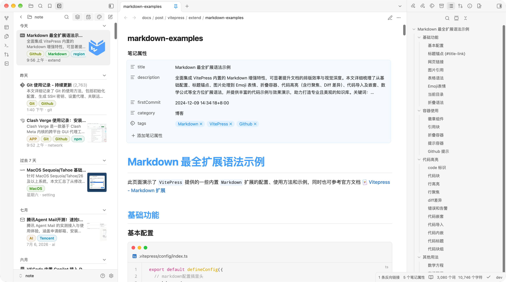

## Feature Showcase

### Frontmatter Properties

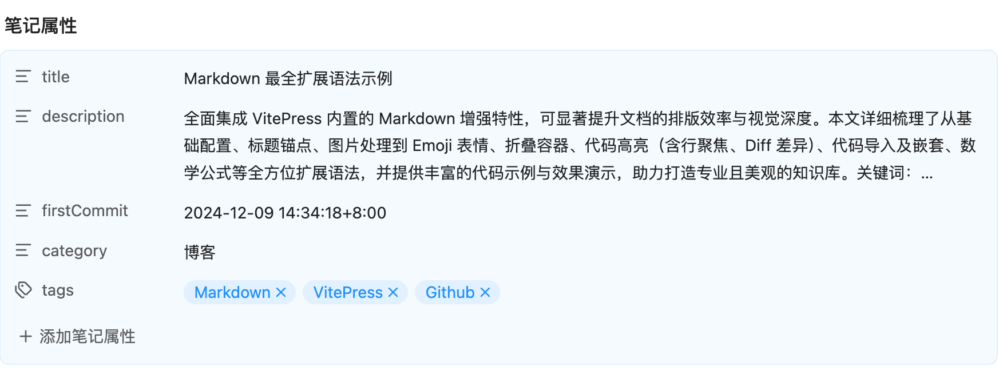

### Headings, Text, Code Blocks & Link Icons

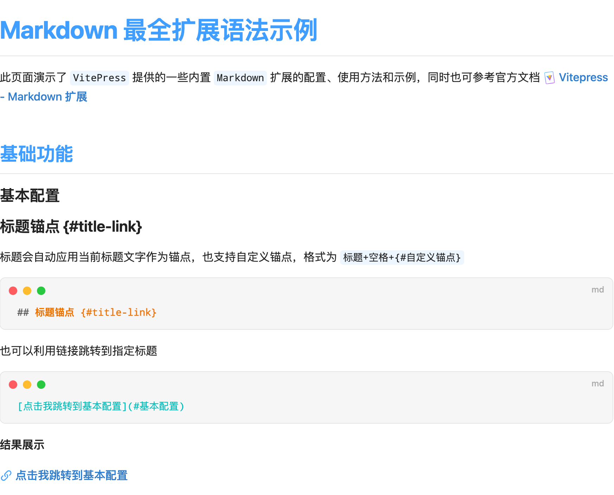

### Emoji

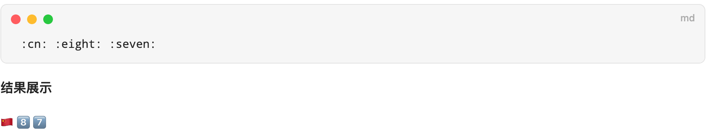

### Badge Component

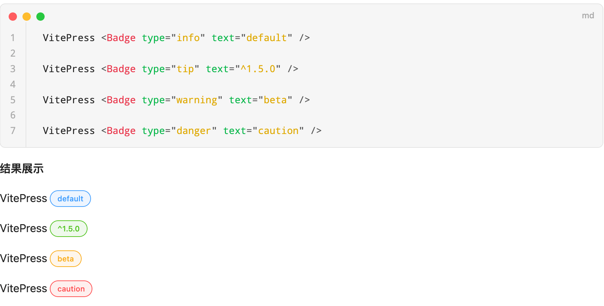

### Blockquotes

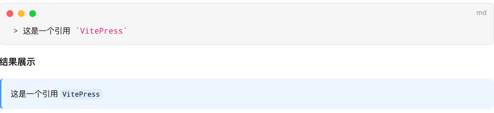

### Collapsible Syntax / Details Container

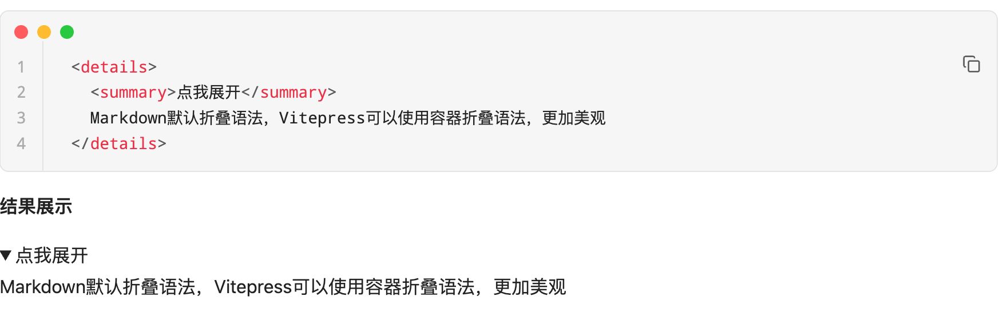

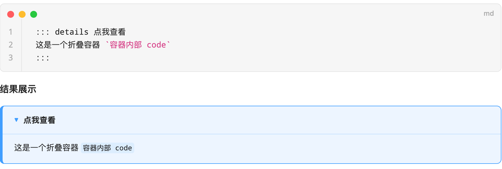

### Alert Containers

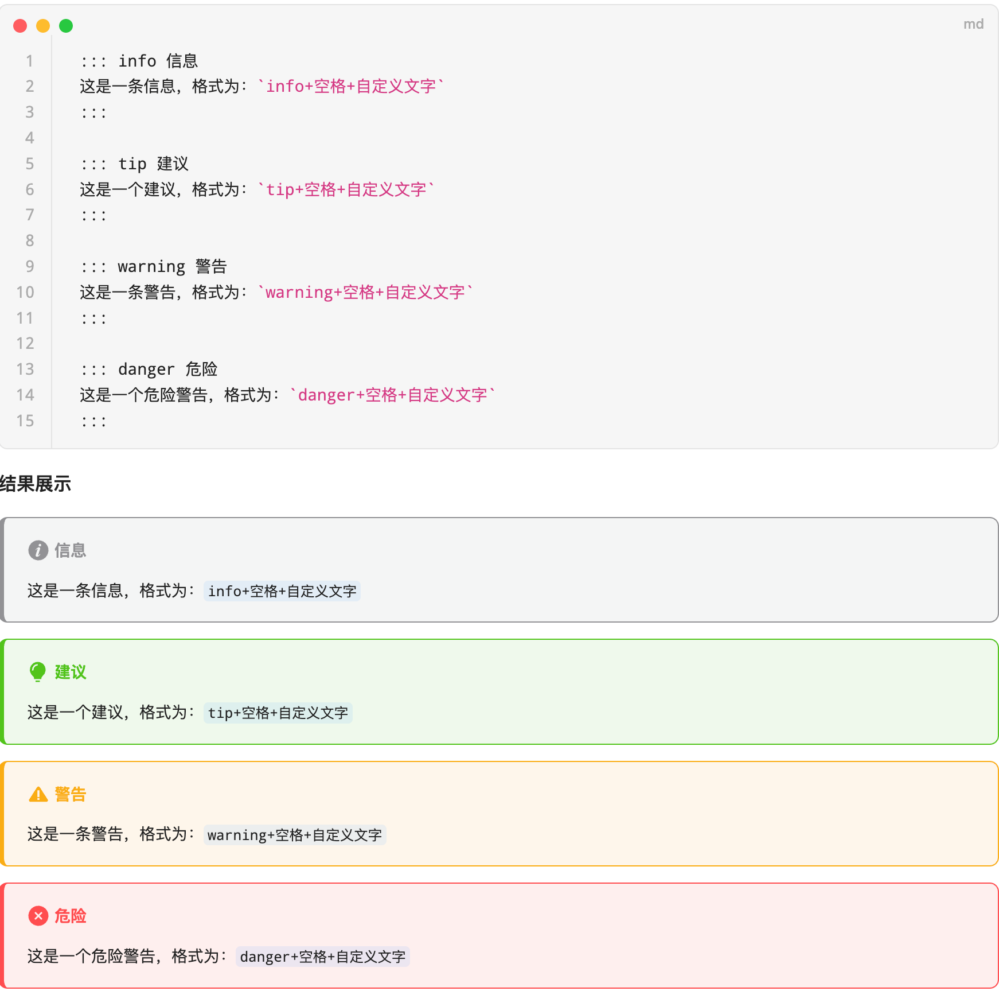

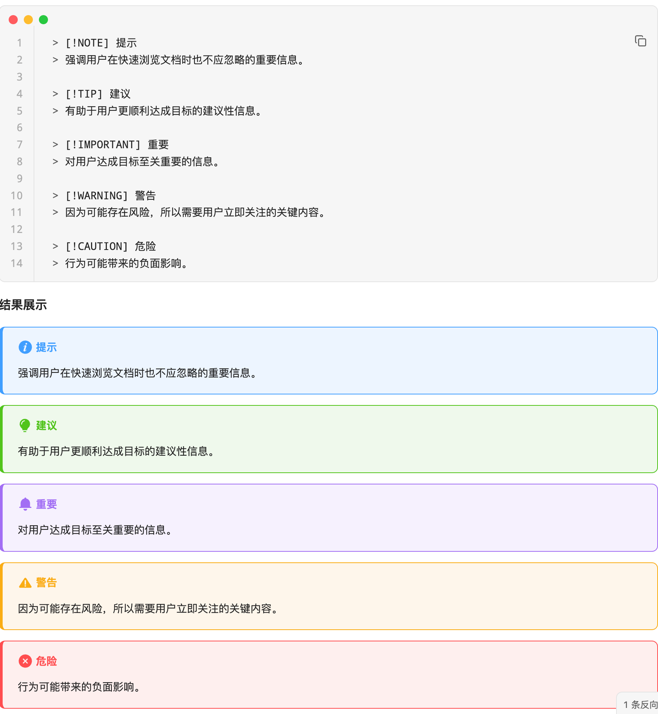

### Code Block Titles & Code Groups

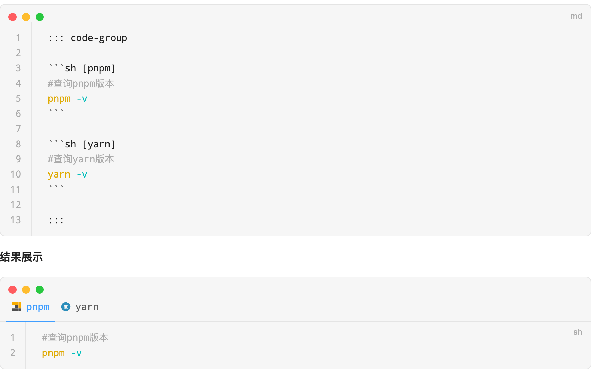

### Code Line Highlighting / Diff / Warning Annotations

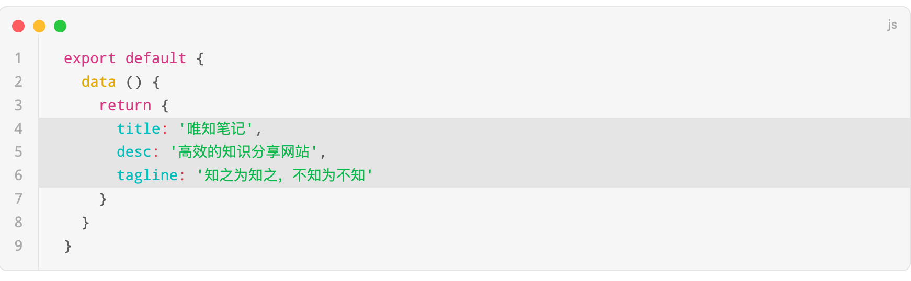

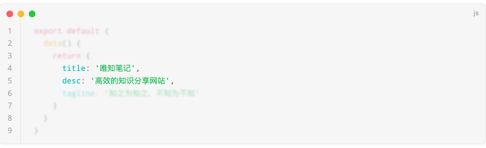

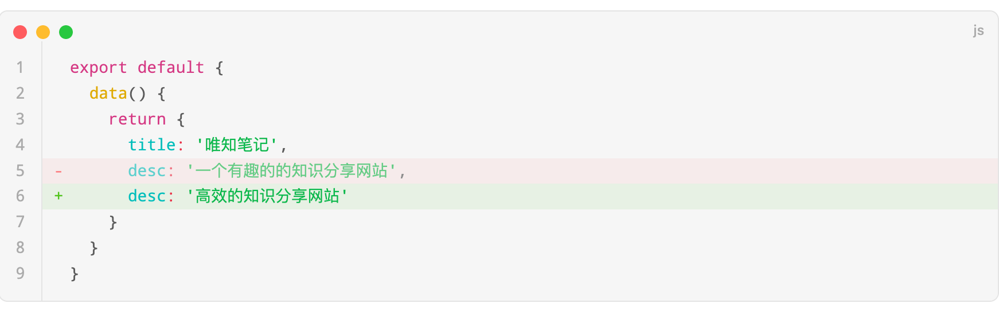

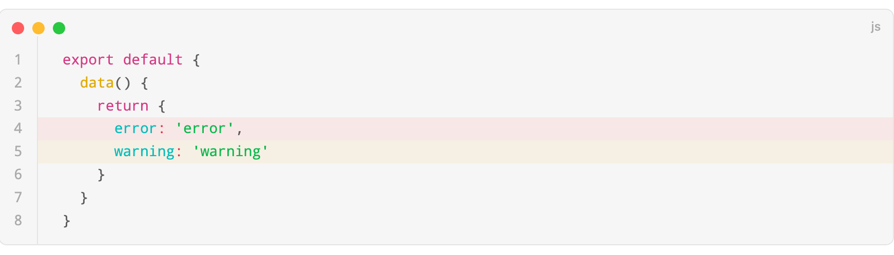

## Compatibility

| Feature                                                                                         | Reading Mode | Live Preview | Source Mode |
| ----------------------------------------------------------------------------------------------- | :----------: | :----------: | :---------: |
| Alert containers (info/note/tip/important/warning/danger/caution)                               |      ✅       |      ❌       |      ❌      |
| Collapsible container (details)                                                                 |      ✅       |      ❌       |      ❌      |
| Badge component (Badge)                                                                         |      ✅       |      ❌       |      ❌      |
| Emoji (`:emoji:`)                                                                               |      ✅       |      ❌       |      ❌      |
| Code group (code-group)                                                                         |      ✅       |      ❌       |      ❌      |
| Code block enhancements (language label / filename / line numbers / highlights / diff / alerts) |      ✅       |      ❌       |      ❌      |
| Link enhancements (external favicons / relative paths / line highlight links)                   |      ✅       |      ❌       |      ❌      |
| Table / Typography styles                                                                       |      ✅       |      ✅       |      ❌      |

## Settings

| Setting                              | Description                                                                                          |     Default     |
| ------------------------------------ | ---------------------------------------------------------------------------------------------------- | :-------------: |
| Display language                     | Choose the language for plugin interface and container labels (Follow Obsidian / English / 简体中文) | Follow Obsidian |
| Follow Obsidian theme                | Automatically adapt brand colors to match Obsidian accent color                                      |        ✅        |
| Custom primary color                 | Brand color for links and accents when not following Obsidian theme                                  |    `#409eff`    |
| Enable typography styles             | Apply VitePress typography (headings, links, lists, and line height)                                 |        ✅        |
| Enable code block styles             | Apply VitePress-style code blocks (window header, language labels, and code groups)                  |        ✅        |
| Enable container styles              | Apply VitePress-style alert and collapsible container styles                                         |        ✅        |
| Code block corner radius             | Border radius in pixels for code blocks and code groups (0–16 px)                                    |       `8`       |
| Show line numbers                    | Display line numbers alongside code blocks in reading view                                           |        ✅        |
| Code line highlights and annotations | Support `{1,3-5}` line highlights and `[!code focus/++/--/error/warning]` markers                    |        ✅        |
| Parse VitePress containers           | Convert `:::` syntax to alert containers, details blocks, and code groups                            |        ✅        |
| Process links                        | Enhance external and VitePress-style internal links                                                  |        ✅        |
| Show external link favicons          | Fetch site favicons for external links via favicon.im                                                |        ✅        |
| Resolve relative links               | Resolve VitePress-style relative paths and `#L10-L15` line highlight links                           |        ✅        |
| Parse VitePress badges               | Convert `<Badge />` syntax to styled inline badges                                                   |        ✅        |
| Parse VitePress emojis               | Convert `:emoji:` shortcodes to emoji icons                                                          |        ✅        |
| Debug mode                           | Enable debug logging in the developer console                                                        |        ❌        |
| Reload styles                        | Reapply theme classes and refresh rendered markdown views                                            |        -        |
| Reset to defaults                    | Restore all options to their default values                                                          |        -        |

## License

MIT
