# VitePress Theme for Obsidian

一个为 Obsidian 设计的 [VitePress](https://vitepress.dev/) 风格主题插件，让以 Vitepress 为基础的站点文档也能在 Obsidian 中获得良好的阅读体验。

**[English Documentation](./README.md)**

主要包含以下功能：

1. 让基础内容样式，包括标题、行高等阅读风格符合 Vitepress 的标准。
2. 正确展现 VitePress 的扩展语法，包括 frontmatter 属性、Emoji 表情、容器、代码块组、代码行高亮/diff/警告等。
3. 对基础样式、代码风格等进行了美化，使阅读界面更加美观。

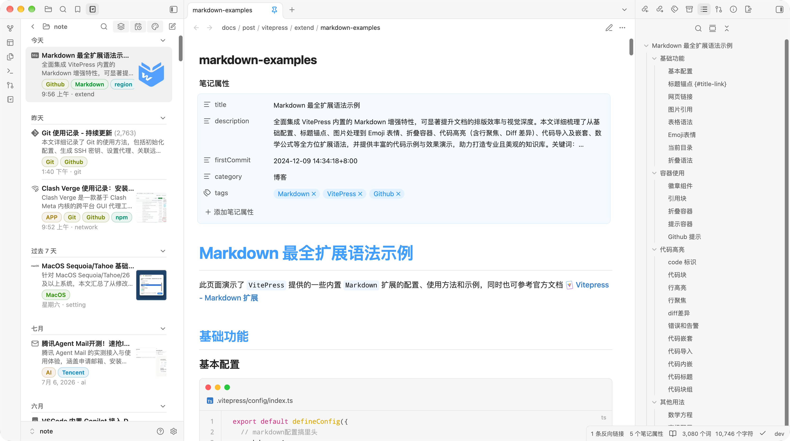

## 功能展示

### frontmatter 属性

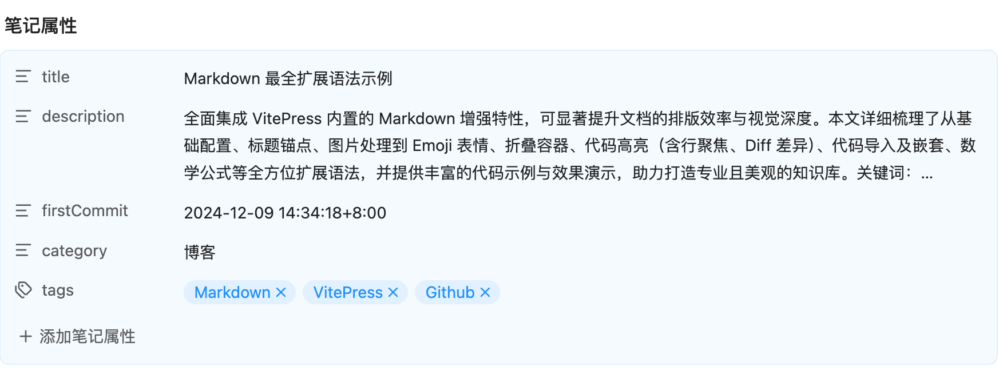

### 标题、文本、代码块、链接图标

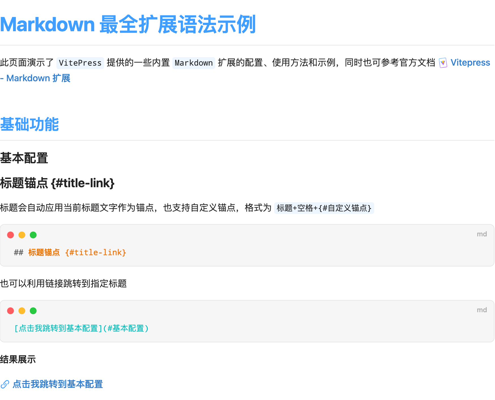

### Emoji 表情

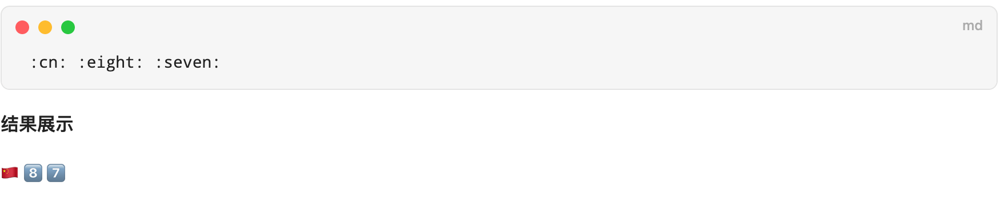

### 徽章组件

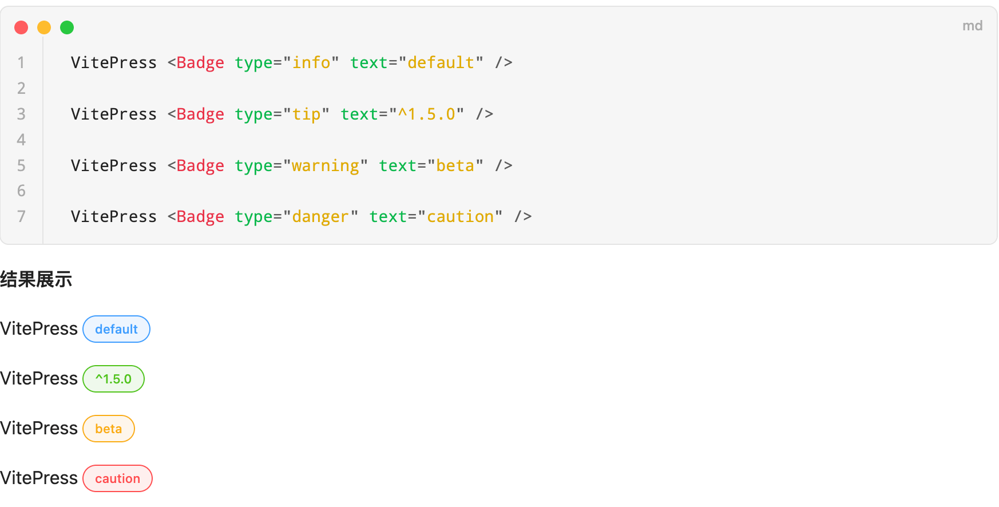

### 引用块

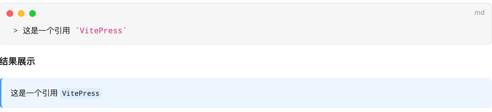

### 折叠语法/折叠容器

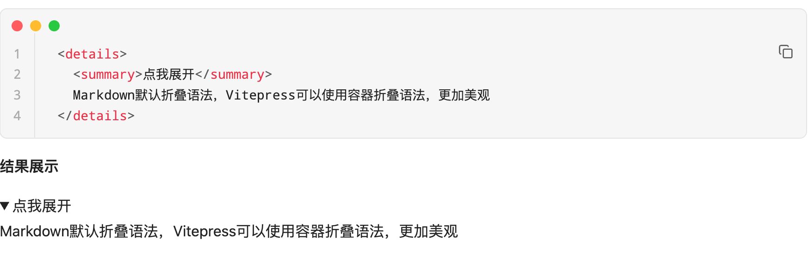

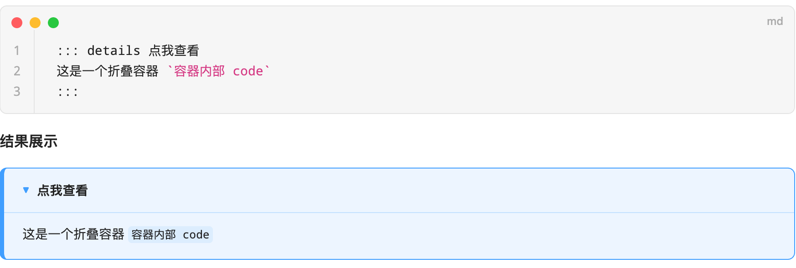

### 提示容器

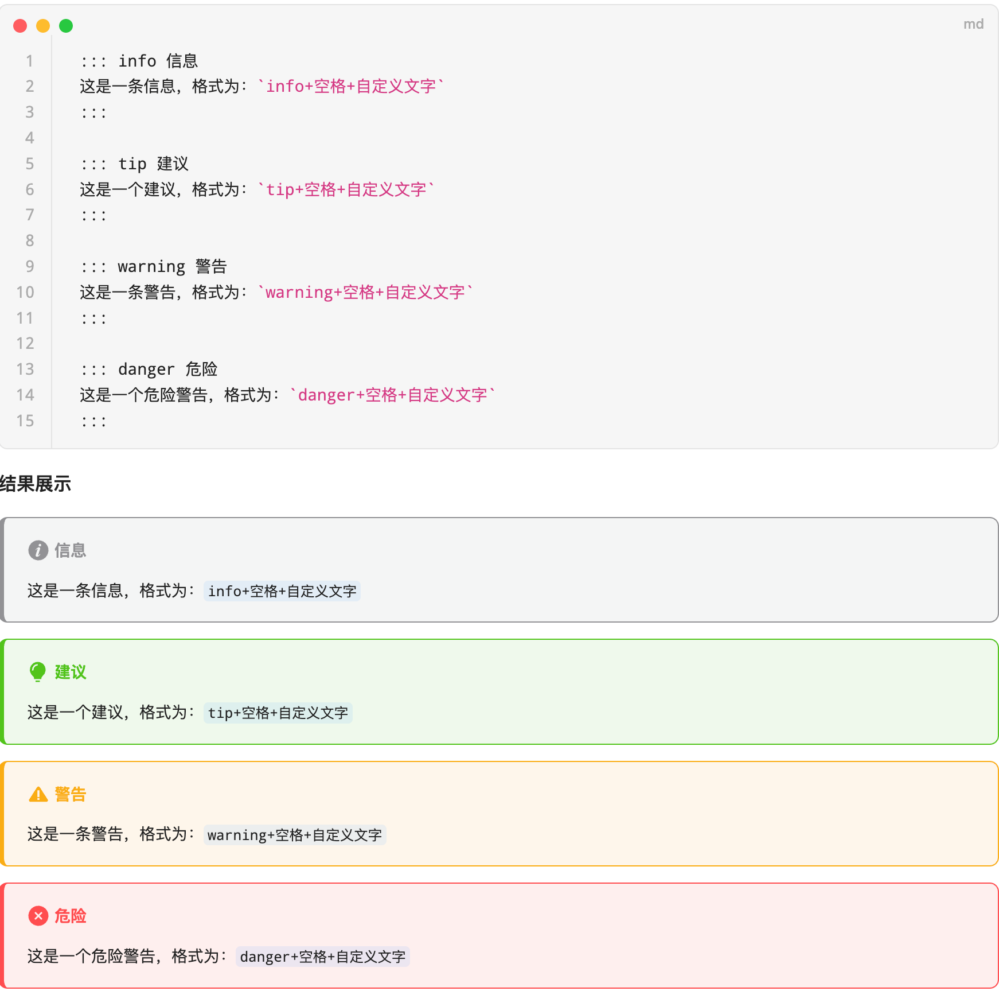

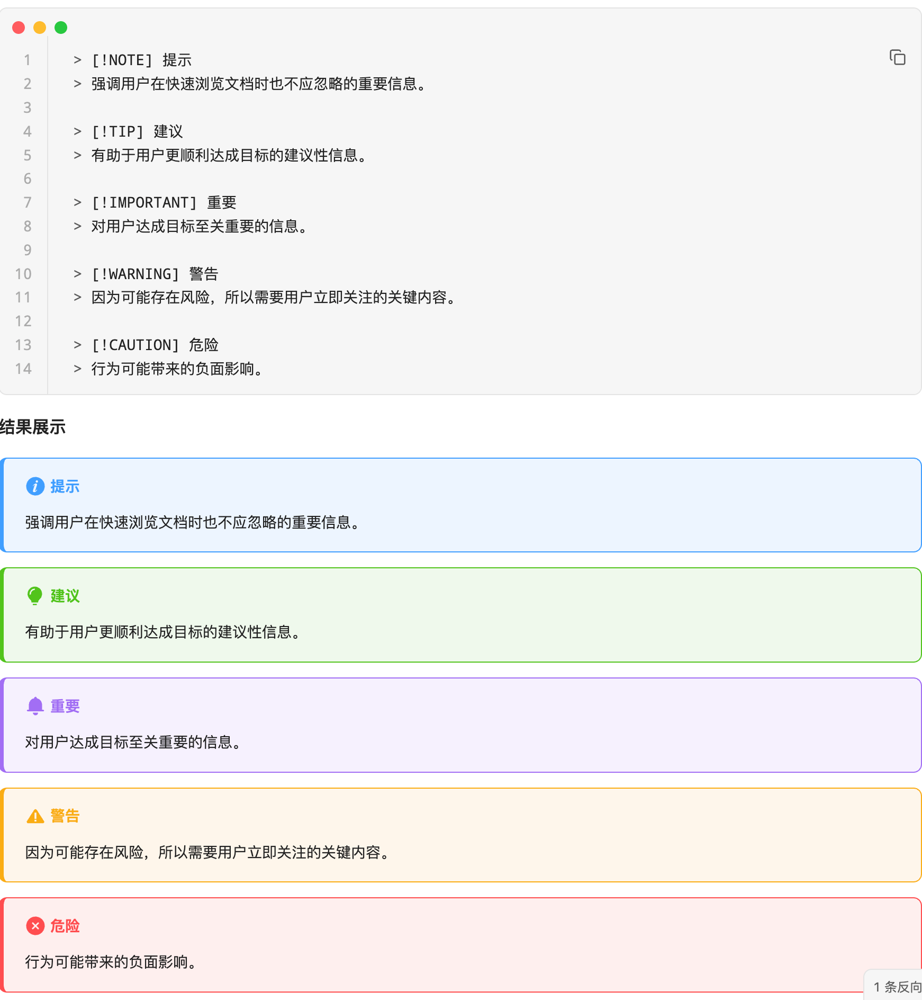

### 代码块标题、代码块组

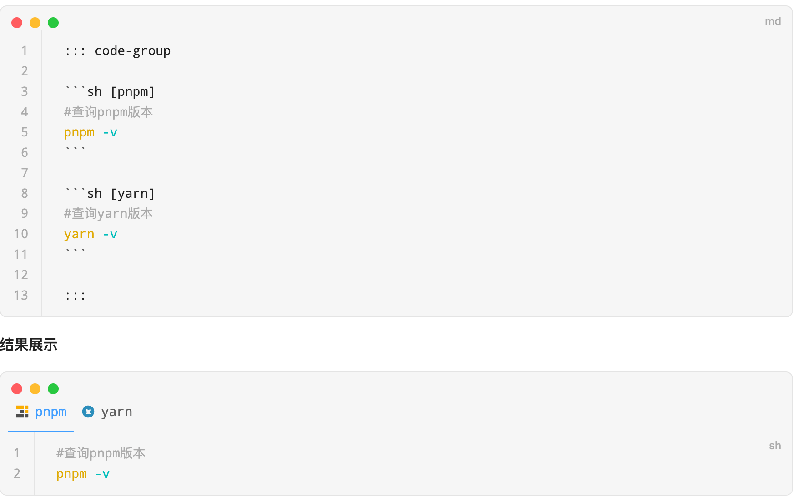

### 代码块行高亮/diff/告警

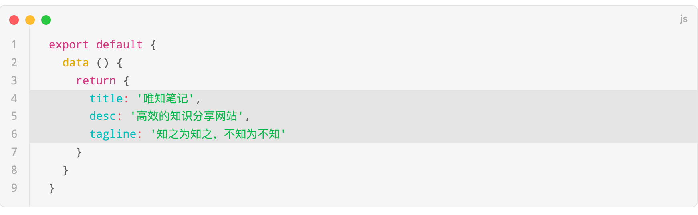

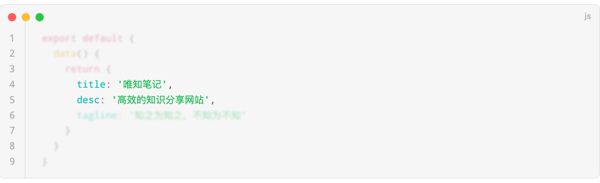

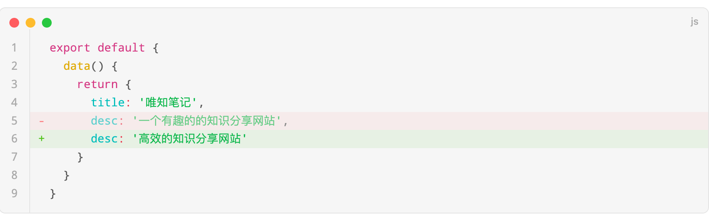

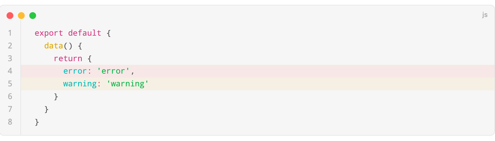

## 兼容性说明

| 特性                                                          | 阅读模式 | 实时预览 | 源码模式 |
| ------------------------------------------------------------- | :------: | :------: | :------: |
| 提示容器（info/note/tip/important/warning/danger/caution）    |    ✅     |    ❌     |    ❌     |
| 折叠容器（details）                                           |    ✅     |    ❌     |    ❌     |
| 徽章组件（Badge）                                             |    ✅     |    ❌     |    ❌     |
| Emoji 表情（`:emoji:`）                                       |    ✅     |    ❌     |    ❌     |
| 代码块组（code-group）                                        |    ✅     |    ❌     |    ❌     |
| 代码块增强（语言标签 / 文件名 / 行号 / 行高亮 / diff / 告警） |    ✅     |    ❌     |    ❌     |
| 链接增强（外链图标 / 相对路径 / 行号链接）                    |    ✅     |    ❌     |    ❌     |
| 表格 / 排版样式                                               |    ✅     |    ✅     |    ❌     |

## 设置项

| 设置                   | 说明                                                                       |    默认值     |
| ---------------------- | -------------------------------------------------------------------------- | :-----------: |
| 显示语言               | 选择插件界面与提示容器默认标题的语言（跟随 Obsidian / English / 简体中文） | 跟随 Obsidian |
| 跟随 Obsidian 主题色   | 自动使用 Obsidian 当前强调色作为品牌主色                                   |       ✅       |
| 自定义品牌主色         | 关闭跟随主题色时使用的自定义品牌颜色                                       |   `#409eff`   |
| 启用排版样式           | 应用 VitePress 排版规范（标题、链接、列表与行高）                          |       ✅       |
| 启用代码块样式         | 应用 VitePress 风格代码块（窗口顶栏、语言标签与代码组）                    |       ✅       |
| 启用容器样式           | 应用 VitePress 风格提示容器与折叠容器样式                                  |       ✅       |
| 代码块圆角             | 设置代码块与代码组容器的圆角大小（0–16 px）                                |      `8`      |
| 显示代码行号           | 在阅读模式下为代码块左侧显示行号                                           |       ✅       |
| 代码块高亮与标记       | 支持 `{1,3-5}` 行高亮及 `[!code focus/++/--/error/warning]` 行内标记       |       ✅       |
| 解析 VitePress 容器    | 将 `:::` 语法解析并渲染为提示容器、折叠块和代码组                          |       ✅       |
| 处理链接               | 增强外部链接与 VitePress 风格内部链接                                      |       ✅       |
| 显示外链图标           | 通过 favicon.im 为外部链接自动加载站点图标                                 |       ✅       |
| 解析相对路径与行号链接 | 支持 VitePress 风格的相对路径和 `#L10-L15` 行号链接                        |       ✅       |
| 解析 VitePress 徽章    | 将 `<Badge />` 语法解析并渲染为行内徽章                                    |       ✅       |
| 解析 VitePress 表情    | 将 `:emoji:` 短代码解析为对应表情符号                                      |       ✅       |
| 调试模式               | 在开发者控制台输出调试日志                                                 |       ❌       |
| 重新加载样式           | 重新应用主题样式并刷新已打开的 Markdown 预览视图                           |       -       |
| 恢复默认配置           | 将所有配置项重置为初始默认值                                               |       -       |

## License

MIT
